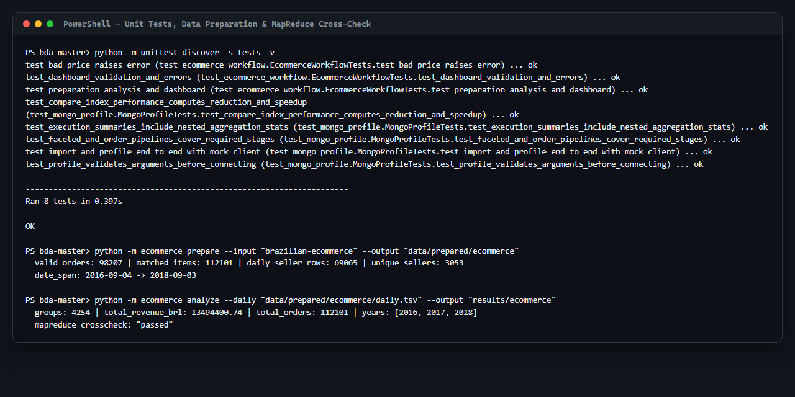
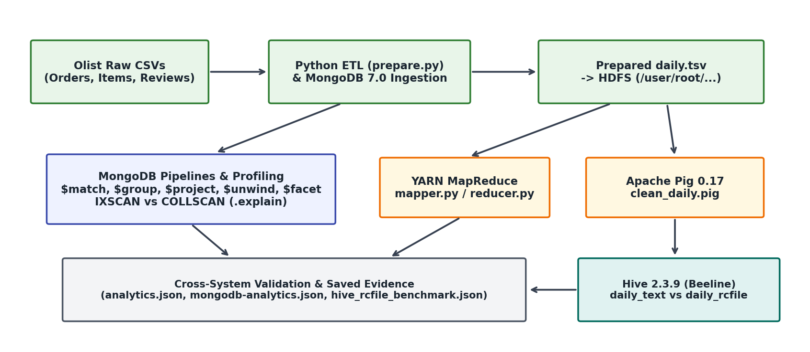
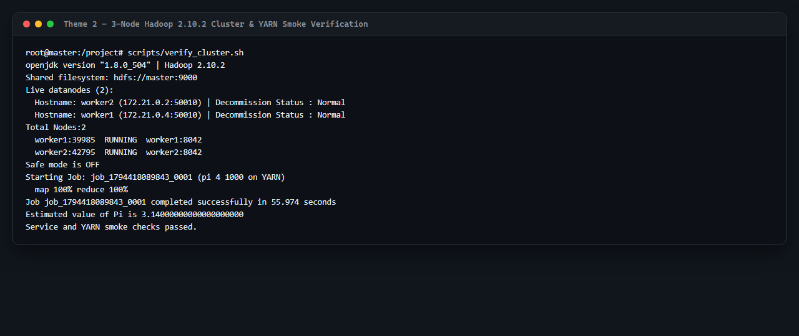
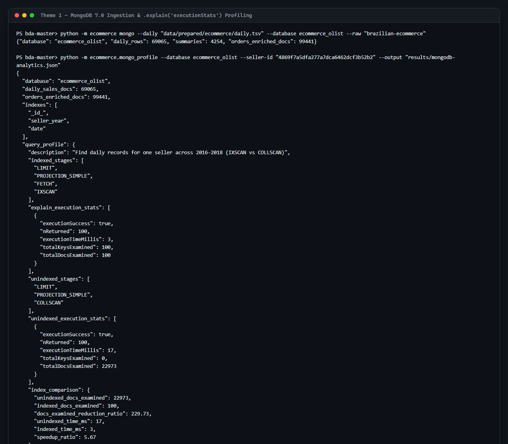
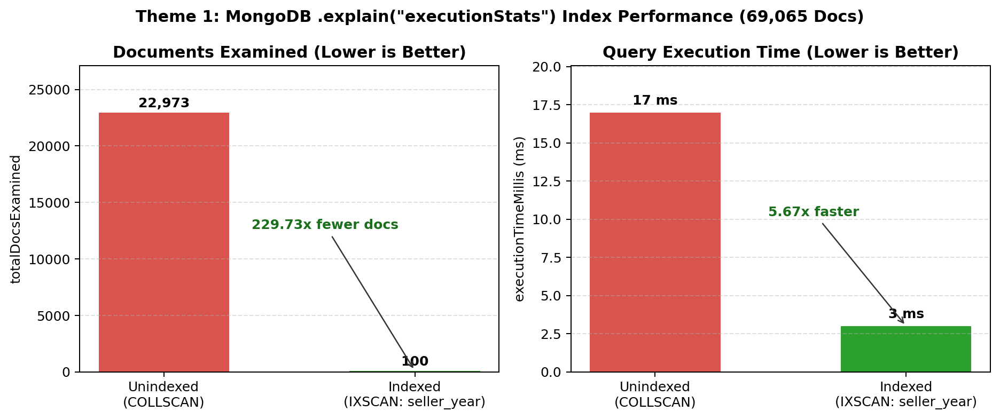
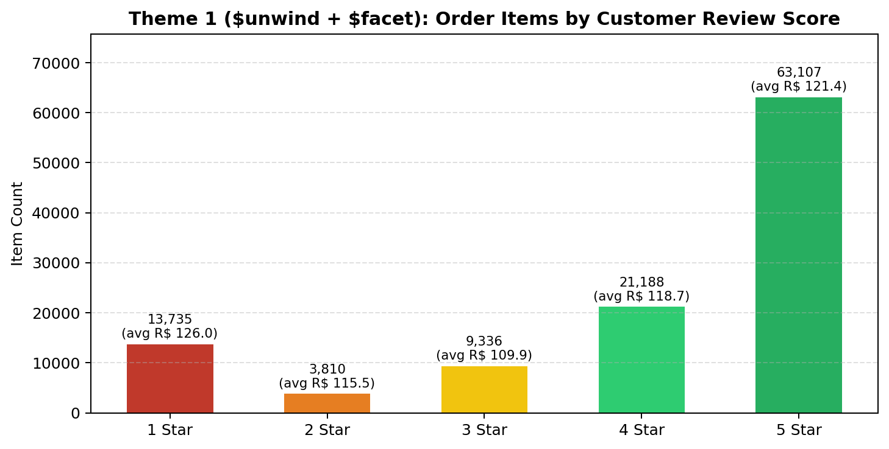
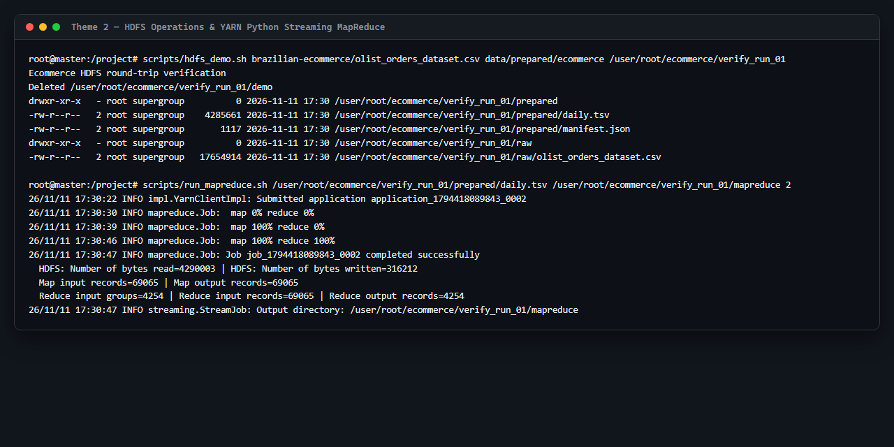
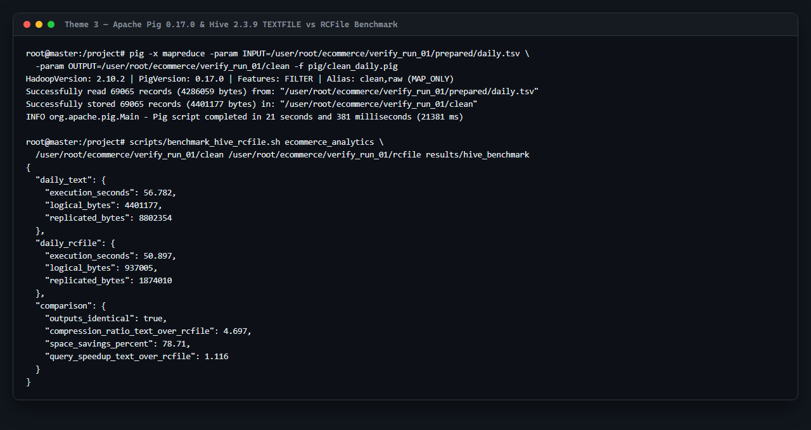
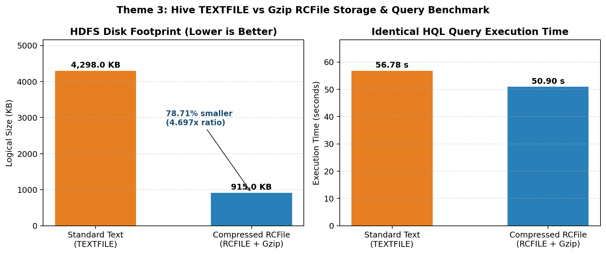

# Assignment 1 Report

## Contents

| Section | Coverage |
|---|---|
| 1. Introduction, Objectives and Dataset | Olist E-Commerce schema, preparation, validation |
| 2. Environment and Architecture | 3-node Docker cluster, MongoDB 7.0, processing flow |
| 3. Cluster Verification | Live DataNodes, RUNNING NodeManagers, YARN Pi smoke test |
| 4. MongoDB Ingestion and Linkage | `daily_sales` & `orders_enriched` collections and indexes |
| 5. MongoDB Aggregation and Profiling | `$match`, `$group`, `$project`, `$unwind`, `$facet`, `IXSCAN` vs `COLLSCAN` |
| 6. HDFS File Management | `mkdir`, `put`, `cat`, `get`, `rm -r`, `ls -R` |
| 7. MapReduce Analytics on YARN | Python Streaming `mapper.py` / `reducer.py` & cross-check |
| 8. Pig Transformation and Hive Tables | `clean_daily.pig`, `daily_text` & Gzip `daily_rcfile` |
| 9. Hive Performance and Storage Results | Identical HQL execution time & `StorageSummary` compression |
| 10. Conclusion and References | Key findings & documentation links |

Dataset: Kaggle Brazilian E-Commerce Public Dataset by Olist (`brazilian-ecommerce/`).

<!-- PAGEBREAK -->

## 1. Introduction, Objectives and Dataset

This project analyses the Kaggle Brazilian E-Commerce Public Dataset by Olist across 2016–2018 using MongoDB, Hadoop MapReduce, Apache Pig, and Apache Hive. Order lifecycle records, item prices, and customer reviews are validated and normalized into daily per-seller transaction summaries (`daily.tsv`). The interactive Flask dashboard presents the verified analytics as Part 2.

| Dataset Item | Raw Input | Prepared / Analysed Output |
|---|---|---|
| Orders (`olist_orders_dataset.csv`) | 99,441 rows | 98,207 valid orders (`canceled`/`unavailable` excluded) |
| Line Items (`olist_order_items_dataset.csv`) | 112,650 rows | 112,101 matched valid items |
| Daily Seller Grain (`daily.tsv`) | — | 69,065 daily rows across 3,053 unique sellers |
| Annual Seller Groups | — | 4,254 `(seller_id, year)` groups (R$ 13,494,400.74 total) |

### 1.1 Selection and Validation Rules
`ecommerce/prepare.py` filters out `canceled` and `unavailable` orders, validates `YYYY-MM-DD` purchase timestamps, rejects blank, negative, or non-finite item prices, and writes `daily.tsv` alongside `manifest.json` with SHA-256 checksums.

## 2. Environment and Architecture

The distributed stack runs on Docker Desktop using a 3-node cluster (`master`, `worker1`, `worker2`) alongside MongoDB `7.0` on `127.0.0.1:27017`.

| Component | Configuration |
|---|---|
| Hadoop / Java | Apache Hadoop `2.10.2`; OpenJDK `1.8.0_504` |
| Analytics Tools | MongoDB `7.0`; Apache Pig `0.17.0`; Apache Hive `2.3.9` |
| Master Node | HDFS NameNode, YARN ResourceManager, JobHistoryServer, HiveServer2 |
| Worker Nodes | `worker1` & `worker2` (2 DataNodes, 2 NodeManagers) |
| Storage | Docker named volumes; HDFS replication factor `2` |

## 3. Cluster Verification

`scripts/verify_cluster.sh` verified the 3-node cluster prior to running analytics: **2 live DataNodes** (`worker1` and `worker2` in `Normal` status), **2 RUNNING NodeManagers**, `Safe mode is OFF`, and a YARN MapReduce `pi 4 1000` smoke test (`job_1794418089843_0001`) completing in `55.974 seconds` (`Estimated value of Pi is 3.14000000000000000000`).

## 4. MongoDB Ingestion and Linkage

Implemented in `ecommerce/mongo.py` (`import_and_analyze` and `_ingest_orders_enriched`) against database `ecommerce_olist`:
- **`daily_sales` (69,065 documents):** Batch-inserted daily seller summaries with compound index `seller_year` (`seller_id`, `year`) and single-field index `date`.
- **`orders_enriched` (99,441 documents):** Links each order to its embedded `items` array and unstructured Portuguese `review` document (`score`, `comment_title`, `comment_message`), indexed on `order_id` (unique), `items.seller_id + order_status`, and `review.score`.

## 5. MongoDB Aggregation and Profiling

Two multi-stage pipelines exercise all five required operators (`$match`, `$group`, `$project`, `$unwind`, `$facet`):
- **`build_faceted_pipeline` on `daily_sales`:** Uses `$match`, `$facet` (`annual_totals`, `top_sellers`, `revenue_tiers` with `$group` and `$project`), and `$unwind: "$annual_totals"`.
- **`build_order_items_pipeline` on `orders_enriched`:** Uses `$match`, `$unwind: "$items"`, and `$facet` (`seller_item_totals` and `review_score_summary`).

`ecommerce/mongo_profile.py` evaluates index efficiency on `daily_sales` (`seller_id = "4869f7a5dfa277a7dca6462dcf3b52b2"`, `limit = 100`) using `.explain("executionStats")`:

| Plan | Winning Stages | `nReturned` | `totalKeysExamined` | `totalDocsExamined` | `executionTimeMillis` |
|---|---|---:|---:|---:|---:|
| Unindexed (`COLLSCAN`) | `LIMIT -> PROJECTION_SIMPLE -> COLLSCAN` | 100 | 0 | 22,973 | 17 ms |
| Indexed (`IXSCAN: seller_year`) | `LIMIT -> PROJECTION_SIMPLE -> FETCH -> IXSCAN` | 100 | 100 | 100 | 3 ms |

## 6. HDFS File Management

Under `/user/root/ecommerce/verify_run_01`, `scripts/hdfs_demo.sh` demonstrated the full HDFS file lifecycle: `hdfs dfs -mkdir -p` (`raw`, `prepared`, `demo`), `hdfs dfs -put` (`olist_orders_dataset.csv` `17,654,914` B, `daily.tsv` `4,285,661` B, `manifest.json` `1,117` B), `hdfs dfs -cat` and `hdfs dfs -get` with byte-level `cmp` verification, and `hdfs dfs -rm -r` on the temporary `demo` folder followed by `hdfs dfs -ls -R`.

## 7. MapReduce Analytics on YARN

`scripts/run_mapreduce.sh` executed Python Streaming MapReduce (`mapreduce/mapper.py` + `mapreduce/reducer.py`) on YARN with 2 reducers (`job_1794418089843_0002`):
- **Map input / output records:** `69,065`
- **Reduce input groups / output records:** `4,254` `(seller_id, year)` summaries
- **HDFS I/O:** `4,290,003` bytes read / `316,212` bytes written (`_SUCCESS` verified)

## 8. Pig Transformation and Hive Tables

`pig/clean_daily.pig` ran in MapReduce mode (`Apache Pig 0.17.0`, `job_1794418089843_0003`) to validate `YYYY-MM-DD` date regex, non-empty `seller_id`, and non-negative numeric metrics, reading and writing `69,065` clean rows (`4,401,177` bytes) in `21.381 seconds`.

`hive/tables.hql` created two external tables in `ecommerce_analytics`: `daily_text` (`STORED AS TEXTFILE`) and `daily_rcfile` (`STORED AS RCFILE` with `GzipCodec`), populated via `INSERT OVERWRITE TABLE daily_rcfile SELECT ... FROM daily_text` and analyzed with `COMPUTE STATISTICS`.

## 9. Hive Performance and Storage Results

`scripts/benchmark_hive_rcfile.sh` executed `hive/annual_seller_summary.hql` via `beeline` (`jdbc:hive2://localhost:10000`) against both tables, verified identical outputs via `diff` (`329,502` bytes each, `outputs_identical: true`), and measured HDFS disk usage via `hadoop/StorageSummary.java`:

| Table Format | Query Execution Time | Logical Bytes | Replicated Bytes (RF=2) | Compression / Savings |
|---|---:|---:|---:|---|
| Standard Text (`daily_text`) | 56.782 s | 4,401,177 B | 8,802,354 B | 1.000x (Baseline) |
| Gzip RCFile (`daily_rcfile`) | 50.897 s | 937,005 B | 1,874,010 B | **4.697x (78.71% saved)** |

## 10. Conclusion and References

All three themes were verified end-to-end on the Olist dataset: MongoDB indexing reduced scanned documents by **229.73x** (`22,973` → `100`) with a **5.67x** speedup; YARN Streaming MapReduce matched Python reference totals across all `4,254` groups; and Gzip RCFile in Hive reduced HDFS storage by **78.71%** (**4.697x** compression) while executing **1.116x** faster with identical query output.

1. Kaggle Brazilian E-Commerce Public Dataset by Olist — https://www.kaggle.com/datasets/olistbr/brazilian-ecommerce
2. MongoDB Aggregation Pipeline & Explain Results — https://www.mongodb.com/docs/manual/core/aggregation-pipeline/
3. Apache Hadoop 2.10.2 Cluster Setup & Streaming — https://hadoop.apache.org/docs/r2.10.2/
4. Apache Pig 0.17.0 Documentation — https://pig.apache.org/docs/r0.17.0/
5. Apache Hive Language Manual — https://cwiki.apache.org/confluence/display/Hive/LanguageManual
