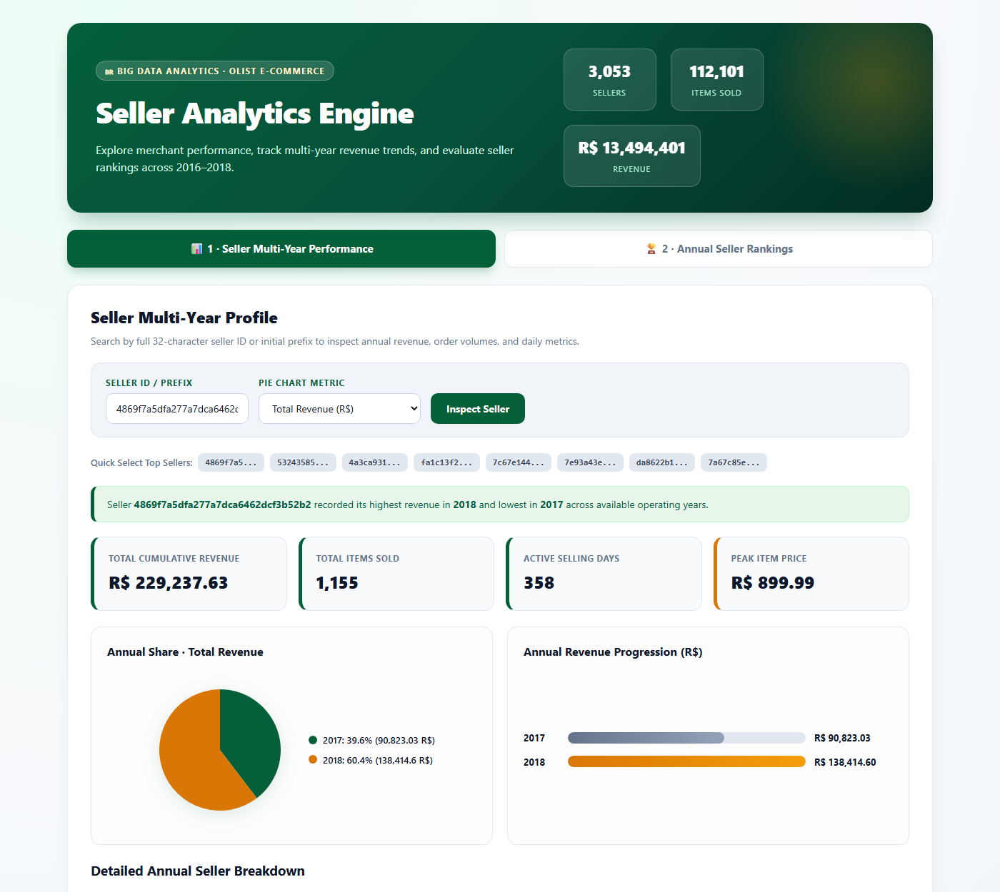
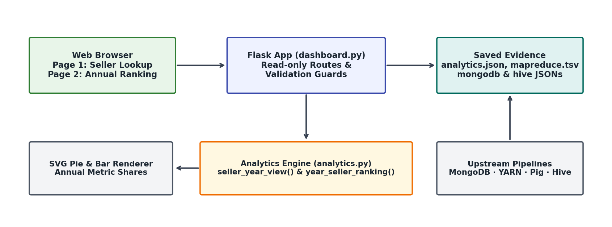
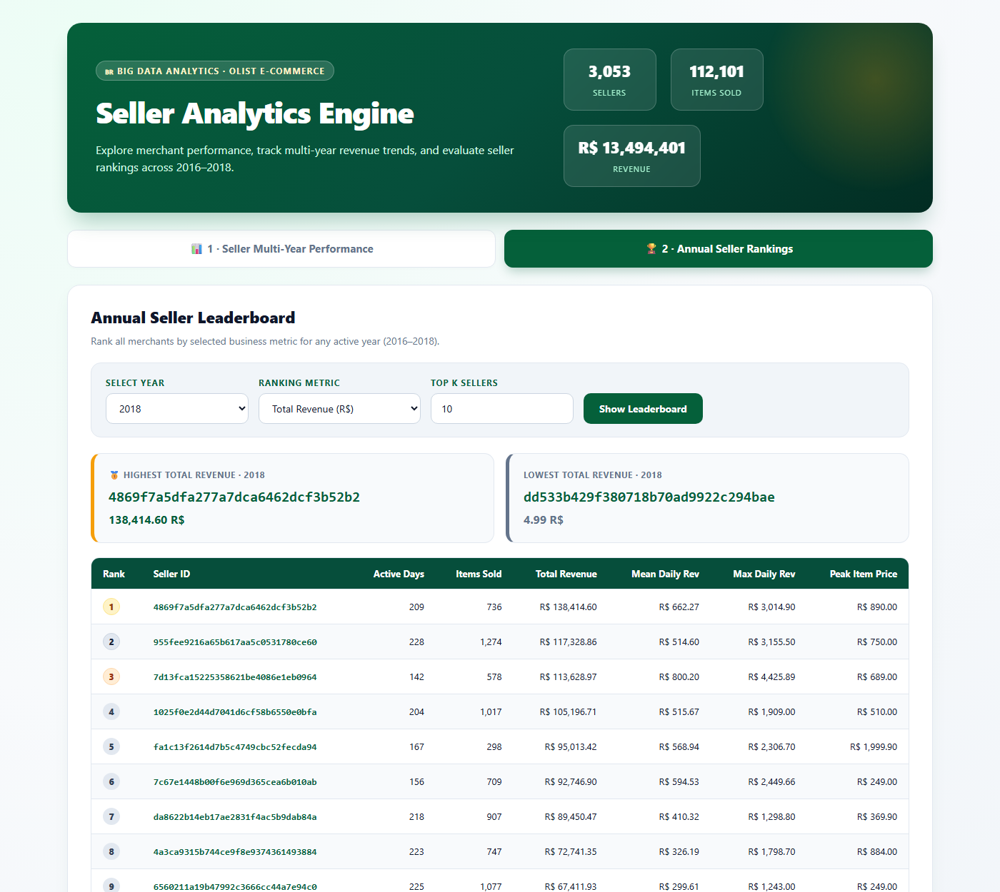
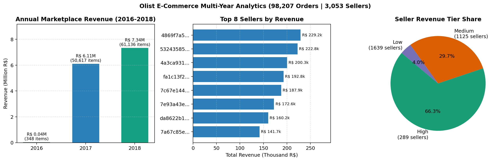
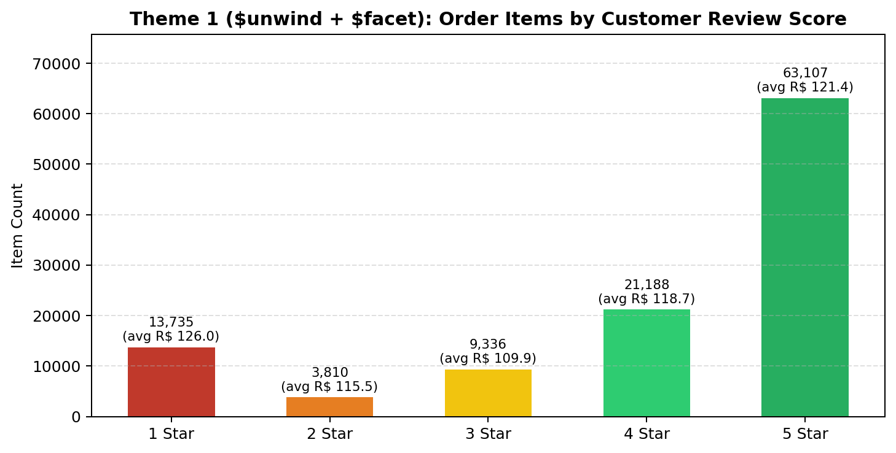
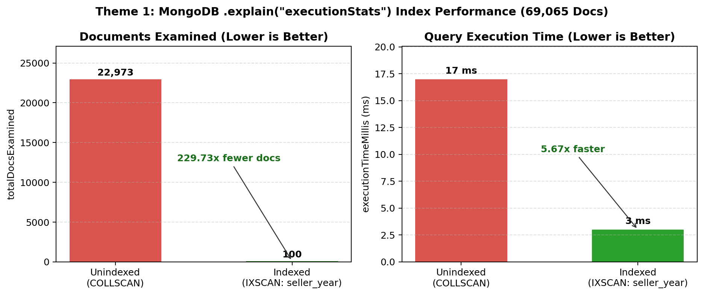
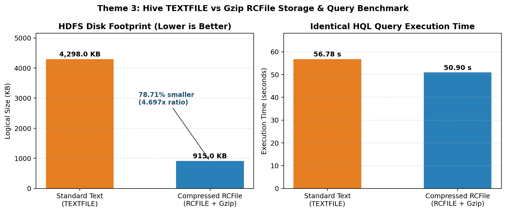

# Assignment 2 Report

## Contents

| Section | Coverage |
|---|---|
| 1. Introduction and Dataset | Flask Seller Analytics Engine & Olist multi-year scope |
| 2. Dashboard Architecture | Read-only Flask serving model, endpoints & validation |
| 3. Seller Multi-Year Performance (Page 1) | Merchant lookup, SVG pie shares & annual progression bars |
| 4. Annual Seller Leaderboard (Page 2) | Year/metric ranking, tie-breaking & top/bottom cards |
| 5. Cross-System Result Presentation | Marketplace growth, revenue tiers & `$unwind` review analytics |
| 6. Performance Evaluation | MongoDB index speedup & Hive RCFile compression findings |
| 7. Conclusion and References | Summary & documentation links |

Dataset: Kaggle Brazilian E-Commerce Public Dataset by Olist (`brazilian-ecommerce/`).

<!-- PAGEBREAK -->

## 1. Introduction and Dataset

The Seller Analytics Engine is the Track B Part 2 web dashboard built with **Flask 3.1.2**, Python, Jinja2 HTML templates, CSS, and inline SVG charts. It serves verified analytical artifacts produced by the Part 1 ingestion, MapReduce, MongoDB, Pig, and Hive pipelines across **98,207** valid orders, **112,101** line items, **69,065** daily records, and **3,053** unique merchants (`2016–2018`, **R$ 13,494,401** total revenue).

## 2. Dashboard Architecture

`ecommerce/dashboard.py` (`create_app`) loads saved JSON results once in read-only mode so heavy distributed computation remains decoupled from interactive web serving. Input validation enforces valid page names, operating years (`2016–2018`), metric keys, and integer `top_k` bounds (`1` to `3,053`), returning HTTP `400` on invalid query parameters and a clean notice on unmatched seller IDs.

| Route / Query Parameter | Function | Purpose |
|---|---|---|
| `GET /` (`page=seller`, default) | `seller_year_view()` | Exact or prefix seller lookup, SVG pie shares, annual breakdown |
| `GET /?page=year&year=...&metric=...&top_k=...` | `year_seller_ranking()` | Ranked annual leaderboard with deterministic `(-metric, seller_id)` tie-break |
| `pie_metric` / `metric` | `METRICS` mapping | Switches between Revenue, Orders, Mean Daily Rev, Max Daily Rev, Peak Order |

## 3. Seller Multi-Year Performance (Page 1)

Page 1 lets evaluators look up any merchant by full 32-character hex ID or initial prefix (with quick-select chips for top merchants). For top merchant `4869f7a5dfa277a7dca6462dcf3b52b2`:
- **Cumulative Revenue:** `R$ 229,237.63` across `1,155` items sold and `358` active days (`Peak Item Price: R$ 899.99`).
- **Annual Share & Progression:** `2017` contributed `39.6%` (`R$ 90,823.03`) while `2018` contributed `60.4%` (`R$ 138,414.60`).

## 4. Annual Seller Leaderboard (Page 2)

Page 2 ranks all merchants operating in a chosen calendar year (`2016`, `2017`, or `2018`) across any of the five business metrics. In the `2018` Total Revenue view (`top_k=10`), `4869f7a5dfa277a7dca6462dcf3b52b2` leads at `R$ 138,414.60` (`209` active days, `736` items), compared against the lowest operating merchant at `R$ 4.99`.

## 5. Cross-System Result Presentation

Aggregations cross-checked across Python reference analytics, YARN MapReduce (`4,254` groups), MongoDB `$facet`/`$unwind`, and Hive HQL reveal strong marketplace growth from `2016` (`R$ 0.04M`, `348` items) to `2017` (`R$ 6.11M`, `50,617` items) and `2018` (`R$ 7.34M`, `61,136` items). Revenue is concentrated among **289** high-tier sellers (`66.3%` of revenue), while order-review `$unwind` + `$facet` analytics show `63,107` 5-star items alongside `13,735` 1-star items.

## 6. Performance Evaluation

Both Theme 1 (MongoDB indexing) and Theme 3 (Hive RCFile compression) performance benchmarks were verified on the live Olist dataset:
- **MongoDB `.explain("executionStats")`:** Compound index `seller_year` reduced examined documents from `22,973` (`COLLSCAN`, `17 ms`) to `100` (`IXSCAN`, `3 ms`) — a **229.73x scan reduction** and **5.67x speedup**.
- **Hive `TEXTFILE` vs Gzip `RCFILE`:** Converting `daily_text` (`4,401,177` B) to `daily_rcfile` (`937,005` B) achieved a **4.697x compression ratio** (**78.71% space savings**) and executed the identical annual seller summary query **1.116x faster** (`50.897s` vs `56.782s`) with identical outputs verified via `diff`.

## 7. Conclusion and References

The Flask Seller Analytics Engine unifies the Olist multi-system Big Data pipeline into an interactive, validated two-page web application backed by **8/8** passing automated tests (`test_ecommerce_workflow.py` and `test_mongo_profile.py`). Decoupling offline batch/NoSQL processing from read-only dashboard rendering keeps UI latency low while preserving exact reproducibility.

1. Kaggle Brazilian E-Commerce Public Dataset by Olist — https://www.kaggle.com/datasets/olistbr/brazilian-ecommerce
2. Flask Documentation — https://flask.palletsprojects.com/
3. MongoDB Aggregation & Query Performance — https://www.mongodb.com/docs/manual/core/aggregation-pipeline/
4. Apache Hadoop & Hive Language Manual — https://cwiki.apache.org/confluence/display/Hive/LanguageManual
