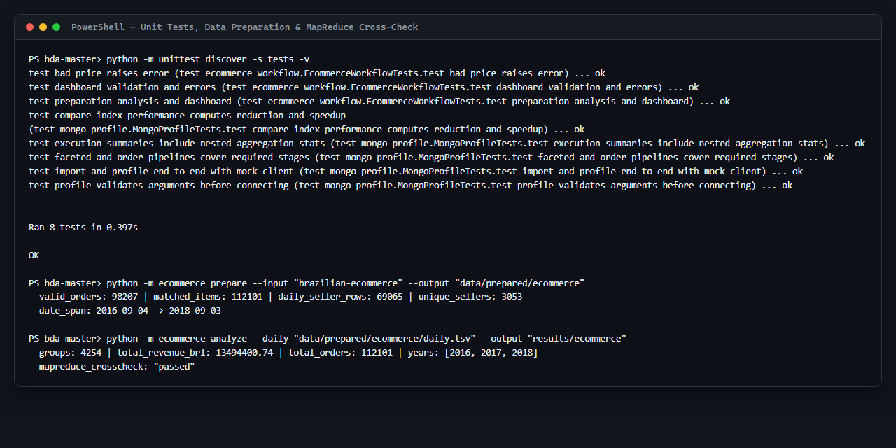
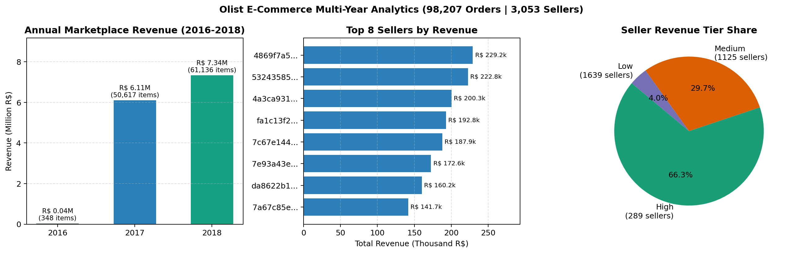
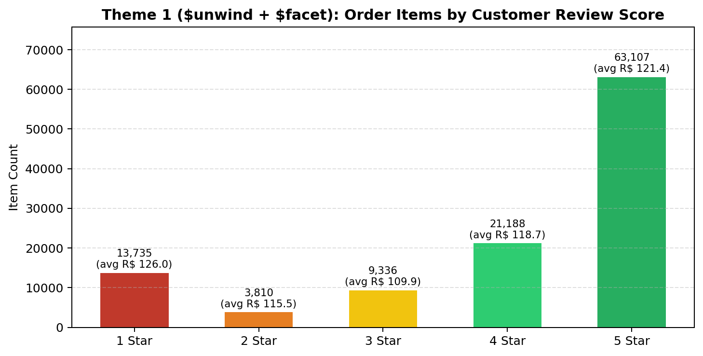
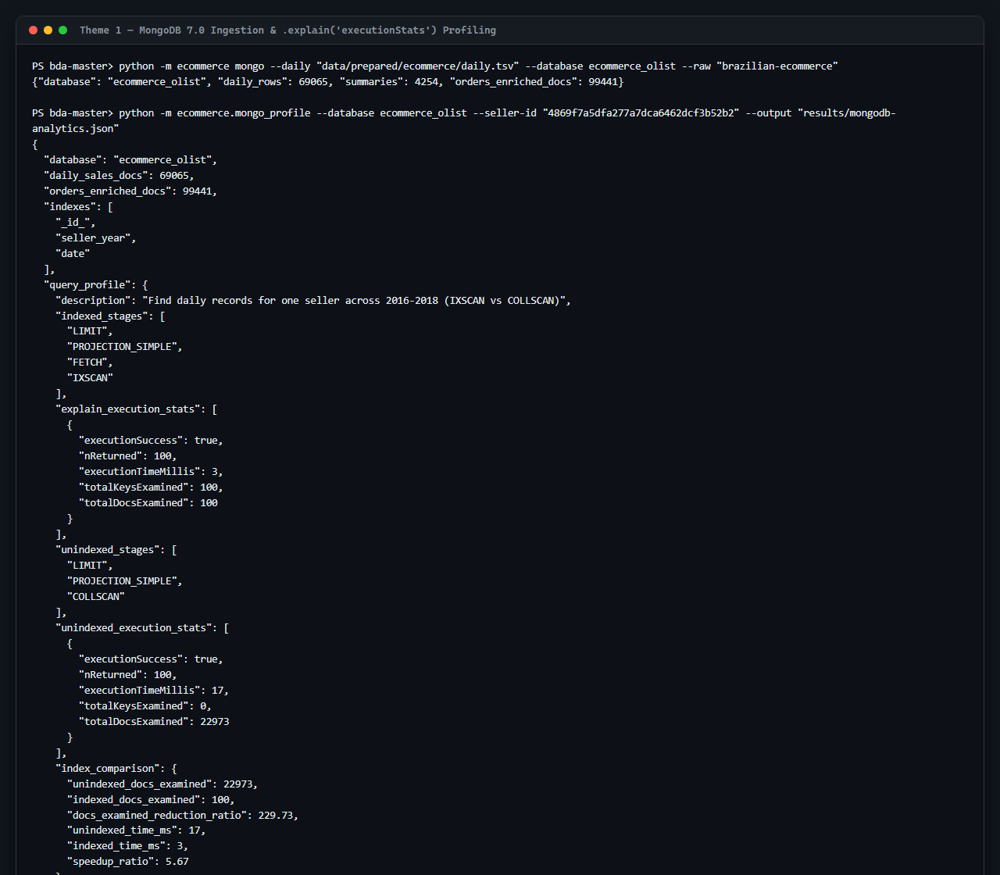
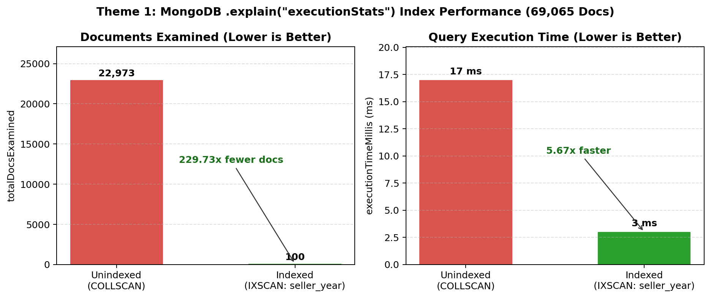
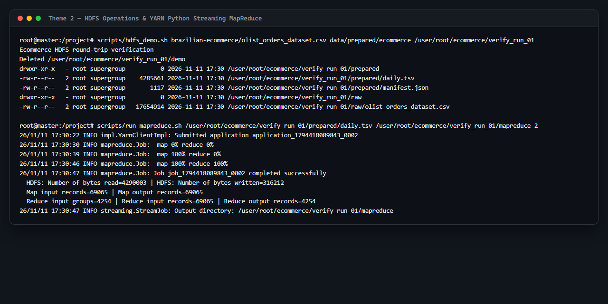
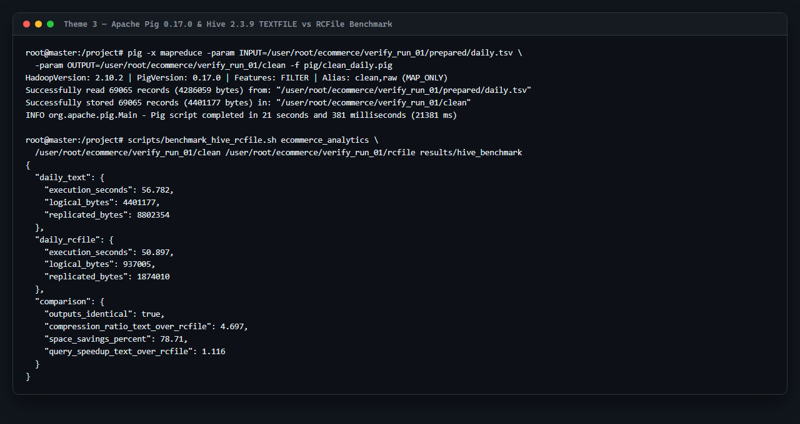
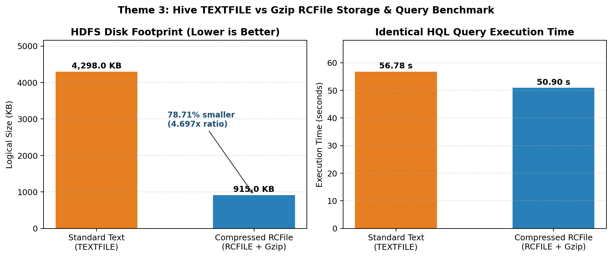
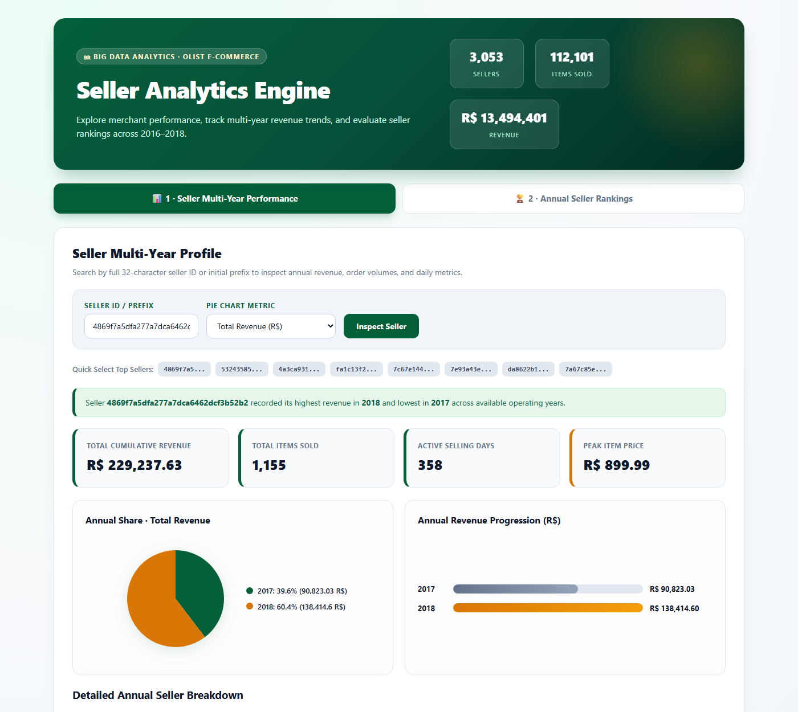
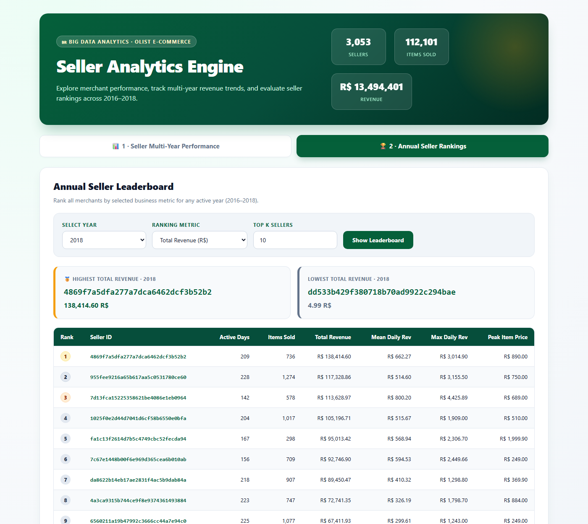

# Big Data Analytics Report: Brazilian E-Commerce (Olist) Multi-System Pipeline

**Dataset:** Kaggle Brazilian E-Commerce Public Dataset by Olist (`brazilian-ecommerce/`)  
**Scope:** 98,207 valid orders · 112,101 matched line items · 69,065 daily seller summaries · 3,053 unique merchants (`2016-09-04` to `2018-09-03`) · R$ 13,494,400.74 total sales

---

## 1. System Architecture & Data Preparation

Raw relational CSVs (`olist_orders_dataset.csv`, `olist_order_items_dataset.csv`, `olist_order_reviews_dataset.csv`) are validated and normalized into daily per-seller records (`daily.tsv` + `manifest.json`) by `ecommerce/prepare.py`. Orders marked `canceled` or `unavailable` are excluded, and non-finite or negative item prices are rejected.

- **Automated Verification (`unittest`):** All **8/8** unit and mock integration tests pass in `0.397s`.
- **MapReduce Cross-Check (`ecommerce/analytics.py`):** Executing `mapreduce/mapper.py` and `mapreduce/reducer.py` locally produces **4,254** `(seller_id, year)` groups matching pure Python reference summaries with `mapreduce_crosscheck: "passed"`.

---

## 2. Assignment Theme 1 — MongoDB Big Data Processing & Analytics

### 2.1 Document Data Ingestion & Indexing
Implemented in `ecommerce/mongo.py` (`import_and_analyze` and `_ingest_orders_enriched`) and executed against **MongoDB 7.0** (`ecommerce_olist` database):
- **`daily_sales` collection (69,065 documents):** Batch-inserted daily seller summaries with compound index `seller_year` (`{"seller_id": 1, "year": 1}`) and single-field index `date` (`{"date": 1}`).
- **`orders_enriched` collection (99,441 documents):** Stores structured order metadata, embedded `items` arrays, and unstructured Portuguese `review` text (`comment_title`, `comment_message`, `score`), indexed on `order_id` (unique), `items.seller_id + order_status`, and `review.score`.

### 2.2 Aggregation Pipelines (`$match`, `$group`, `$project`, `$unwind`, `$facet`)
- **`build_faceted_pipeline` on `daily_sales`:** Filters years (`$match`), fans out via `$facet` into `annual_totals`, `top_sellers`, and `revenue_tiers` (`$group` + `$project`), then flattens annual buckets via `$unwind: "$annual_totals"` and `$project`.
- **`build_order_items_pipeline` on `orders_enriched`:** Filters fulfilled orders (`$match`), unpacks embedded order line items via `$unwind: "$items"`, and branches via `$facet` into `seller_item_totals` and `review_score_summary`.

### 2.3 Query Performance Profiling (`.explain("executionStats")`)
Implemented in `ecommerce/mongo_profile.py` (`profile_database`), comparing the same seller lookup (`seller_id = "4869f7a5dfa277a7dca6462dcf3b52b2"`, `limit = 100`) with and without the `seller_year` compound index:

| Execution Plan | Winning Stages | `nReturned` | `totalKeysExamined` | `totalDocsExamined` | `executionTimeMillis` |
|---|---|---:|---:|---:|---:|
| **Unindexed (`hint: {$natural: 1}`)** | `LIMIT -> PROJECTION_SIMPLE -> COLLSCAN` | 100 | 0 | 22,973 | 17 ms |
| **Indexed (`seller_year`)** | `LIMIT -> PROJECTION_SIMPLE -> FETCH -> IXSCAN` | 100 | 100 | 100 | 3 ms |

- **Result:** The compound index achieves a **229.73x reduction** in scanned documents and a **5.67x execution speedup**.

---

## 3. Assignment Theme 2 — Hadoop File Management & MapReduce Analytics

### 3.1 Distributed Cluster & HDFS Operations
A 3-node Docker cluster (`master`, `worker1`, `worker2` running Hadoop `2.10.2`) was verified with `scripts/verify_cluster.sh`: **2 live DataNodes**, **2 RUNNING NodeManagers**, `dfs.replication = 2`, and YARN `pi 4 1000` completing in **55.974s**.

`scripts/hdfs_demo.sh` executed the full HDFS lifecycle under `/user/root/ecommerce/verify_run_01`:
- `hdfs dfs -mkdir -p` (`raw`, `prepared`, `demo`)
- `hdfs dfs -put` (`olist_orders_dataset.csv` — 17,654,914 bytes; `daily.tsv` — 4,285,661 bytes; `manifest.json` — 1,117 bytes)
- `hdfs dfs -cat` and `hdfs dfs -get` + byte-level `cmp` verification on `probe.txt`
- `hdfs dfs -rm -r` on the temporary `demo` directory and `hdfs dfs -ls -R`

### 3.2 YARN Python Streaming MapReduce
`scripts/run_mapreduce.sh` executed `mapreduce/mapper.py` and `mapreduce/reducer.py` on YARN (`job_1794418089843_0002`, 2 reducers):
- **Map input / output records:** `69,065`
- **Reduce input groups / output records:** `4,254` `(seller_id, year)` summaries
- **HDFS bytes read / written:** `4,290,003` bytes read / `316,212` bytes written

---

## 4. Assignment Theme 3 — Pig Latin & Hive RCFile Performance Analytics

### 4.1 Data Transformation in Apache Pig
`pig/clean_daily.pig` ran in MapReduce mode (`Apache Pig 0.17.0`, `job_1794418089843_0003`) to validate `YYYY-MM-DD` date format, non-empty `seller_id`, and non-negative numerical metrics:
- **Records read / stored:** `69,065` / `69,065` (`4,401,177` bytes written to `/user/root/ecommerce/verify_run_01/clean`)
- **Pig execution time:** `21.381 seconds` (`MAP_ONLY`)

### 4.2 Hive Text vs Compressed RCFile Benchmark
`scripts/benchmark_hive_rcfile.sh` created external `daily_text` (`TEXTFILE`) and Gzip-compressed `daily_rcfile` (`RCFILE` + `GzipCodec`) tables via `hive/tables.hql`, executed the identical analytical query `hive/annual_seller_summary.hql` via `beeline` against `HiveServer2`, verified output equivalence with `diff` (`329,502` bytes each, `outputs_identical: true`), and measured HDFS byte footprints using `hadoop/StorageSummary.java`:

| Hive Table Format | Query Execution Time | Logical HDFS Size | Replicated HDFS Size (RF=2) | Compression / Savings |
|---|---:|---:|---:|---|
| **Standard Text (`daily_text`)** | 56.782 s | 4,401,177 B (4,298.0 KB) | 8,802,354 B | Baseline (1.000x) |
| **Gzip RCFile (`daily_rcfile`)** | 50.897 s | 937,005 B (915.0 KB) | 1,874,010 B | **4.697x compression (78.71% saved)** |

- **Query speedup:** `daily_rcfile` completed the identical aggregation **1.116x faster** (`50.897s` vs `56.782s`) while reducing HDFS disk usage by **78.71%**.

---

## 5. Interactive Analytics Dashboard

The Flask application (`ecommerce/dashboard.py`) serves the validated analytical outputs across two interactive views:
1. **Page 1 — Seller Multi-Year Performance:** Seller lookup (`4869f7a5dfa277a7dca6462dcf3b52b2`: R$ 229,237.63 cumulative revenue, 1,155 items sold, 358 active days, R$ 899.99 peak item price), dynamic SVG pie share, and annual revenue progression bars.
2. **Page 2 — Annual Seller Leaderboard:** Year-filtered ranking (2018 Top 10 by Total Revenue), highlighting highest (`4869f7a5dfa277a7dca6462dcf3b52b2`, R$ 138,414.60) and lowest (`dd533b429f380718b70ad9922c294bae`, R$ 4.99) merchants.

